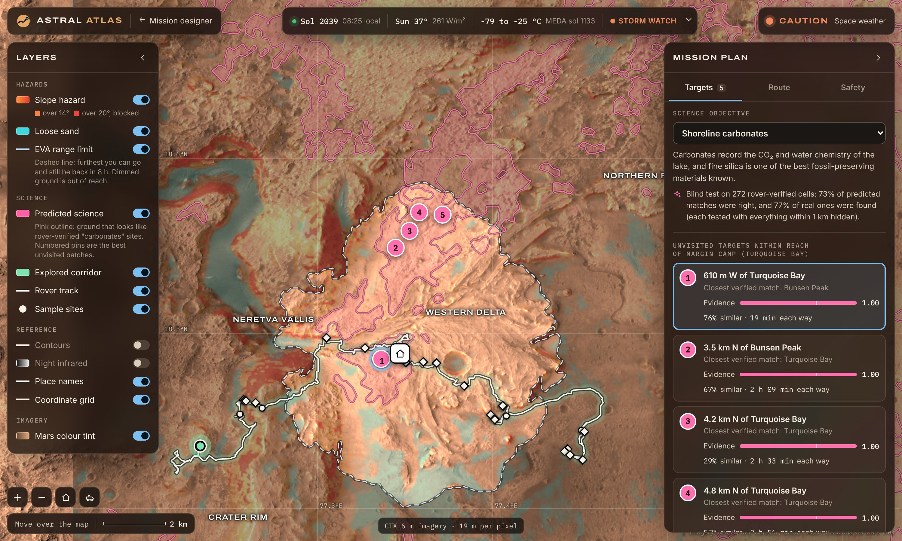
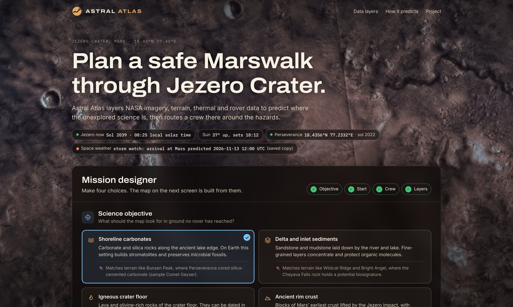
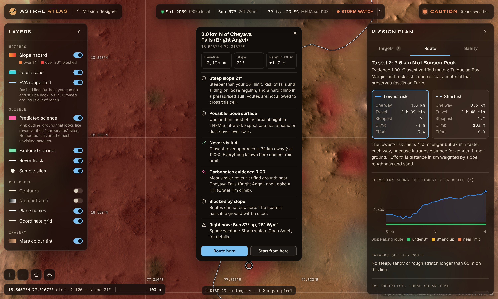
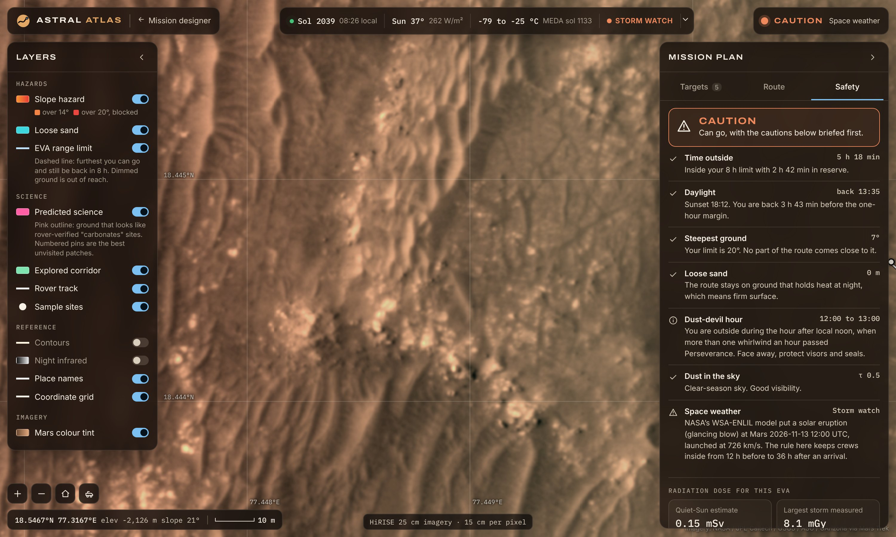

# Astral Atlas

**A Marswalk planner for Jezero Crater, built from real NASA data.**
Team Astral Atlas, NASA Space Apps Challenge ("Martian map making").

> How can existing NASA data be used to predict unknown geological and mineral features in Jezero Crater, and serve as a map for future astronaut research?



| Mission designer | Click any spot: what is wrong here | Zoom to 25 cm HiRISE |
|---|---|---|
|  |  |  |

## Project summary

An astronaut picks a science goal and a starting point. Astral Atlas then:

1. **Predicts where the science is.** Every place Perseverance stopped is labelled with the geologic setting of that mission campaign. For each 80 m cell of Jezero, six NASA measurements (elevation, slope, roughness, night and day infrared temperature, brightness) are compared with those rover-verified cells. The three closest matches vote, and unvisited ground with a strong match becomes a ranked target.
2. **Routes the crew there safely.** A least-cost search over the 20 m NASA elevation model compares the shortest passable route with the lowest-risk one, penalising slope, rough ground and loose sand, and never crossing ground steeper than the crew's limit.
3. **Says go or no-go.** A live panel tracks Jezero local time, daylight and sunlight, Perseverance's position, and solar storms that NASA predicts will reach Mars, and checks the plan against them.

Click anywhere on the map to see what is wrong with that ground (slope, sand, roughness), whether a rover has ever been there, how well it matches the science goal, and whether it can be reached.

## Run it

Open `index.html` in a browser. Nothing to install or build.

- Page 1 (`index.html`) is the mission designer. Choose objective, start, crew limits and layers, then **Generate mission map**.
- Page 2 (`map.html`) is the full-screen map.

An internet connection is needed for the imagery, which streams from NASA Mars Trek. The rover position, weather and solar-storm feeds are read live from NASA each time the map opens; if one cannot be reached the app uses a saved copy (dated 14 Nov 2026) and labels it as such.

On the map: scroll to zoom, drag to pan, click any ground for its hazard read-out, switch layers in the left panel, and pick targets or compare routes in the right panel. The bar at the top opens live conditions; the badge at top right is the go / no-go.

### Publish on GitHub Pages

1. Create a repository and upload everything in this folder.
2. Repository **Settings → Pages → Deploy from a branch → main / root**.
3. The site appears at `https://<your-username>.github.io/<repository>/`.

Optional: get a free key at <https://api.nasa.gov/> and put it in `js/config.js`. The default `DEMO_KEY` works but allows only a few space-weather requests per hour.

## Data layers (all NASA / USGS)

| Kind | Product | Used for |
|---|---|---|
| Optical | MRO HiRISE 25 cm, MRO CTX 6 m, Viking colour 232 m (NASA Mars Trek tiles) | Base map; zoom from the crater to single boulders |
| Topographic | MRO CTX stereo elevation model, 20 m (USGS Astrogeology) | Elevation, slope, roughness, routes, range |
| Thermal | Mars Odyssey THEMIS night and day infrared, 100 m | Loose sand versus bedrock; predictor input |
| Ground truth | Mars 2020 traverse and waypoints (mars.nasa.gov), NASA sample catalogue | Explored corridor, predictor labels, rover position |
| Atmospheric | MEDA weather feed, NASA GISS Mars24 clock, NASA TM-102299 sunlight model | Local time, daylight, sunlight, temperature, pressure |
| Radiation | NASA CCMC DONKI (WSA-ENLIL), Curiosity RAD dose rate | Solar-storm watch, EVA dose estimate |

## What is measured and what is assumed

- **Measured:** imagery, elevation, slope, thermal data, the rover track and sample sites, MEDA readings, DONKI storm arrivals. The elevation model was checked against 708 Perseverance positions: mean difference 0.8 m, standard deviation 3.2 m.
- **Modelled:** Mars time and Sun position (Mars24 algorithm), sunlight (Beer's law plus the TM-102299 net-flux table), the evidence score, routes and travel times.
- **Assumed (you can change them in the designer):** walking speed 2.5 km/h and rover speed 8 km/h on firm flat ground, slope limits, time limits, the one-hour sunset margin and the solar-storm shelter window. These are planning inputs, not NASA flight rules.
- **Known limits:** the evidence score is a relative ranking, not a probability. Blind tests (hiding everything within 1 km of each known point) are shown on the map for each objective; for carbonates, 73% of predicted matches were right. NASA's public MEDA feed last carried measurements on sol 1133, so temperature and pressure show the range to expect rather than today's weather. Dust opacity has no public live feed and is set by the user. The Mars colour tint is cosmetic: HiRISE and CTX are black-and-white cameras.

## The predictor

`tools/astral_atlas_predictor.py` is the team's original Python model (synthetic demo). `js/predictor.js` is its port to the browser: the same weighted three-nearest-neighbour evidence score, 0.65 threshold, held-out check, edge-cost formula and shortest-versus-lowest-risk route comparison, now running on real terrain. The header of that file lists what changed.

## Rebuild the data

```bash
pip install numpy scipy pillow tifffile imagecodecs
```

```bash
python3 tools/build_data.py
```

This downloads the NASA products and regenerates `js/data/terrain.js`, `js/data/rover.js` and the images in `assets/`.

## Files

```
index.html            mission designer
map.html              full-screen mission map
js/predictor.js       evidence ranking and route search (port of the Python)
js/terrain.js         terrain grid, hazard descriptions
js/mars-time.js       Mars clock, Sun position, sunlight model
js/live.js            live NASA feeds with saved-copy fallback
js/map-app.js         map page logic
js/contour.js         outlines and soft-edged overlays
js/designer.js        designer page logic
js/atlas-data.js      sites, campaigns, objectives, sources
js/data/              generated NASA data
tools/                data build script and the original Python predictor
vendor/leaflet/       Leaflet 1.9.4 (BSD-2-Clause)
```

## Sources

NASA Mars Trek; USGS Astrogeology (CTX and HiRISE Jezero mosaics and DEM); Mars 2020 mission location data (NASA/JPL-Caltech); NASA Perseverance Mars Rock Samples; MEDA (NASA/JPL-Caltech/CAB); NASA CCMC DONKI; Appelbaum & Flood 1989, NASA TM-102299; Allison & McEwen 2000 (NASA GISS Mars24); NASA/JPL Curiosity RAD results; NASA "Perseverance Studies the Wild Winds of Jezero Crater"; NASA/JPL PIA26402 and PIA26476. Links are in the app and in `js/atlas-data.js`.

Imagery credit: NASA / JPL-Caltech / USGS / ASU / University of Arizona / MSSS. Fonts: Archivo, Inter, IBM Plex Mono (SIL Open Font License).
